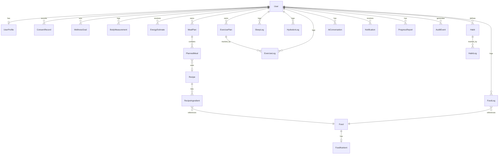

# LifeWise AI — Architecture and Delivery Plan

Status: **Phase 3b service layer done (auth, consent, profile, export, deletion), tested against PostgreSQL. HTTP/UI layer not started.**
This file is the single source of truth for scope. Update it when a phase changes status.

## 1. Scope decision

The surrounding repository (`/`) is **AccreditGenius**, an unrelated accreditation product.
LifeWise AI lives in `lifewise/` as an isolated sub-project with its own `package.json`,
Prisma schema, and tests. The root app's `tsconfig.json` and `eslint.config.mjs` exclude
`lifewise/` so the two do not interfere. Nothing in the accreditation app was modified,
apart from those two exclude lines.

If LifeWise should instead be a new repository, `lifewise/` can be moved with `git subtree split`
without code changes.

## 2. Technical architecture

```
Browser (PWA, Next.js App Router, next-intl ar/en, RTL)
   │  HTTPS, session cookie (HttpOnly, SameSite=Lax)
   ▼
Presentation layer      app routes / server components / forms (React Hook Form + Zod)
   │
Authorization layer     session → userId; every data call takes userId from the session,
   │                    never from the request body
Validation layer        Zod schemas (src/lib/validation) — server boundary
   │
Business logic          domain services (planned: src/lib/services)
   │
   ├── Calculation engine  src/lib/calc   pure, deterministic, no I/O, unit-tested
   ├── AI orchestration    planned: src/lib/ai (provider-agnostic, optional, see §5)
   └── Data access         Prisma (src/lib/db, planned) — PostgreSQL
Audit + notifications   AuditEvent table; background jobs for reminders (planned)
```

Principles enforced in the code so far:

- **Calculations are pure functions** with explicit units (kg, cm, years, ml, minutes).
  They return *estimates* with `assumptions` and `warnings`, never bare numbers.
- **Safety rules live in the engine**, not in the AI or the UI. Examples: the calorie floor,
  refusal of weight-loss targets for underweight BMI, the pregnancy and under-18 refusals,
  and the single-entry hydration limit.
- **Input is validated twice in principle**: Zod on the server is authoritative; the client may
  pre-validate for UX only.

## 3. Calculation engine (`src/lib/calc`)

| Module | Function(s) | Basis (see `sources.ts`) |
|---|---|---|
| `bmi.ts` | `calculateBmi`, `classifyBmi`, `assessBmi`, `healthyWeightRangeKg`, `waistToHeightRatio` | BMI-FORMULA, BMI-WHO-CLASS, BMI-HEALTHY-RANGE, WHTR-SCREEN |
| `energy.ts` | `mifflinStJeorRmr`, `estimateTdee`, `estimateEnergy` | RMR-MIFFLIN, TDEE-MULTIPLIERS, CAL-GOAL-ADJ, CAL-FLOOR |
| `nutrition.ts` | `macroTargets`, `kcalFromMacros`, `fiberTargetG`, `aggregateNutrition`, `percentOfGoal` | ATWATER-FACTORS, AMDR-MACROS, PROTEIN-RDA, FIBER-AI |
| `hydration.ts` | `hydrationReference`, `beverageProgress`, `validateSingleIntakeMl` | WATER-AI-2004 |
| `sleep.ts` | `sleepDurationMinutes`, `bedtimeConsistencyMinutes`, `sleepRangeStatus` | SLEEP-AASM-SRS-2015 |
| `trends.ts` | `linearSlope`, `weeklyChange`, `movingAverage`, `completionRate` | Descriptive statistics |

**Non-calculated pathway.** When sex is "not specified", the energy estimate is refused with
`status: "unavailable"` and `pathway: "non_calculated_guidance"`. When the user is under 18,
pregnant or lactating, or underweight and requesting a weight-loss target, the estimate is
refused and routed to clinician review. The user is never given a silent default.

**Reference cases.** The tests in `tests/calc.test.ts` use hand-computed values (for example,
Mifflin–St Jeor male 30 y / 80 kg / 180 cm = 1780 kcal; female 30 y / 65 kg / 165 cm = 1370 kcal).
Every calculation in the engine has at least one such case.

## 4. Data model (`prisma/schema.prisma`)

Covers all entities in the brief: User, UserProfile, ConsentRecord, WellnessGoal, BodyMeasurement,
EnergyEstimate, Food, FoodNutrient, Recipe, RecipeIngredient, MealPlan, PlannedMeal, FoodLog,
ExercisePlan, ExerciseLog, SleepLog, HydrationLog, Habit, HabitLog, AiConversation, Notification,
ProgressReport, AuditEvent.

Validated with `prisma validate` and `prisma generate` (Prisma 6.19.3). **No migration has been
created or applied yet** because there is no PostgreSQL instance in this environment.



Idempotency: `FoodLog`, `ExerciseLog`, and `HydrationLog` carry a `clientKey` with a unique
`(userId, clientKey)` constraint, so retried or duplicated submissions are not double-counted.

## 5. AI integration design (planned, not implemented)

Pipeline: user request → authentication → context retrieval (minimised) → safety validation →
provider call (timeout, retries, rate limit, token accounting) → structured-output validation
(Zod) → nutrition/rule verification by the engine → persistence → UI.

- AI may **generate** meal combinations and explanations. It may not **compute** nutrition totals
  or override the engine's safety decisions.
- The provider is behind an interface, so it can be swapped. Credentials come only from
  server-side environment variables.
- Every AI feature has a deterministic fallback, and the app works with AI disabled.

## 6. Security and privacy (planned controls, status in brackets)

- Authentication (services): implemented. scrypt password hashing (parameters stored with each hash), 256-bit opaque
  session tokens stored as SHA-256 hashes, 14-day expiry, sessions revoked on logout and account deletion,
  login rate limit (5 failures per 15 minutes per email, in-memory), generic credential errors and timing-equalised
  unknown-user path. **[services done; no cookies or HTTP yet]**
- Password reset, email verification, OAuth: **[not started]**
- Authorization: every service takes the authenticated userId; cross-user isolation is tested (profile, consents, export). **[services done]**
- Health data: sex, conditions, and medications are treated as sensitive. Field-level encryption at
  rest is planned. Conditions and medications are collected only after explicit consent. **[not started]**
- Audit: `AuditEvent` written for register, login, failed login, logout, consent change, profile update, export, and deletion. Field values are never logged. **[done]**
- Compliance: Saudi PDPL and hosting or transfer assessments are **not** done. No compliance claim is made.
  The app is a wellness tool, not a medical device. **[not assessed]**

## 7. Source registry

`src/lib/calc/sources.ts` records each health-related rule with its citation, year, population,
uncertainty, and verification status. **All entries are currently `pending_primary_source_check`.**
Citations were written from the author's knowledge and have not yet been checked against the
primary publications. A test enforces that every entry has a valid status. Do not present any rule to
users as verified until its entry is upgraded by a reviewer who has read the source.

## 8. Phase status

| Phase | Scope | Status |
|---|---|---|
| 1. Requirements & architecture | Architecture, ERD, file structure, roadmap | **Done** (this document) |
| 2. Design system | Tokens, components, RTL, i18n | Not started |
| 3a. Calculation engine | BMI, energy, macros, hydration, sleep, trends | **Done, 42 tests passing** |
| 3b. Auth & onboarding (services) | Registration, login, sessions, consent, profile, export, deletion | **Done, 11 DB integration tests + 6 security tests passing** |
| 3b. Auth & onboarding (HTTP & UI) | Route handlers, cookies, CSRF, onboarding screens | Not started |
| 3c. Persistence | Migration `20261014185509_init_phase1` + `Session` table applied to PostgreSQL 16 | **Done (dev and test DBs)** |
| 3d. Feature screens | BMI, calorie, dashboard, food, exercise, sleep, hydration logging | Not started |
| 4. AI features | Meal generation, coach, insights | Not started |
| 5. Advanced wellness | Habits, reports, notifications, shopping list | Not started |
| 6. Testing & hardening | E2E, accessibility, security tests | Not started |
| 7. Deployment | Env templates, migrations, runbook | Not started |

## 9. Planned file structure

```
lifewise/
  docs/ARCHITECTURE.md
  prisma/schema.prisma
  src/lib/calc/          ← implemented (pure engine)
  src/lib/validation/    ← implemented (Zod boundary schemas)
  src/lib/services/      ← implemented (auth, consent, profile, account; userId-scoped)
  src/lib/security/      ← implemented (scrypt passwords, session tokens, rate limiter)
  src/lib/db/            ← implemented (Prisma client handle)
  src/lib/ai/            ← planned (provider interface, prompts, validators)
  src/app/               ← planned (Next.js App Router; i18n under [locale])
  tests/                 ← implemented (unit) and tests/integration (PostgreSQL)
```

## 10. Known limitations and open risks

- No UI and no HTTP API yet. Services are callable but unreachable from a browser.
- Registration returns EMAIL_TAKEN for a registered email, which lets someone check whether an address has an account.
  Accepted for now; revisit with an email-verification flow.
- The login rate limiter is in-memory and per process. It must move to a shared store before running more than one instance.
- No CSRF protection, cookies, password reset, or email verification yet. These belong to the HTTP layer.
- Account deletion is a hard delete. Retention rules for backups are not defined.
- Source citations are unverified (see §7).
- Activity multipliers and goal adjustments are conventions. Individual energy expenditure can differ
  substantially. Estimates come with stated uncertainty and should not be read as measurements.
- BMI is a screening measure, and the thresholds are population-level. It does not measure body fat.
- The calorie floors (1200 female / 1500 male) are conventions, not validated individual thresholds.
- Nutrition data is not yet connected to a food database. Provenance fields exist, but no dataset is
  loaded.
- Health-data encryption, retention policy, backups, and legal review are not in place.
